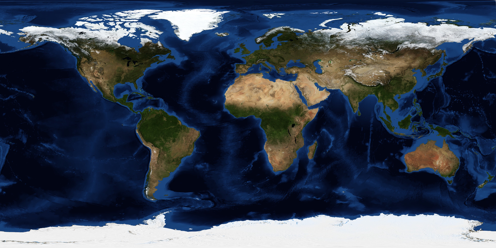

# 乌托邦 · 3D 战略游戏

基于 **Three.js** 的 3D 地球战略游戏，灵感来自 AOH3（历史时代三·虚革）的 UI 风格与玩法机制。单文件 HTML 实现，无需任何依赖，浏览器直接打开即可游玩。



## 快速开始

直接使用浏览器打开 `index.html`（推荐 Chrome / Edge）。

> 需要联网加载 Three.js（通过 CDN 引入）。

## 玩法

1. **点击地球** → 射线检测命中省份 → 预览国旗 → 确认后进入游戏
2. **左键拖拽**：旋转地球
3. **滚轮**：缩放（仅游戏阶段可用）
4. **鼠标中键拖拽**：框选省份（批量操作）
5. **Space**：暂停 / 继续时间
6. **Escape**：取消选择 / 关闭弹窗

## 游戏系统

### 国家与省份
- 60+ 国家真实 GDP / 人口数据
- 省份独立经济值，支持"国家 → 省份"两级选择

### 经济系统
- 金币收入、人力增长、威望、外交点每时间刻度自动结算
- 经济值随游戏动态波动

### 建筑系统
5 种建筑（每个省份独立建造）：

| 建筑 | 效果 | 上限 |
|------|------|------|
| 🛤 陆上交通 | 军队移速 +15%/级 | Lv.3 |
| 🚢 海上运输 | 经济 +3/级（仅沿海） | Lv.3 |
| 🏗 基础设施 | 经济 +2/级 | Lv.5 |
| 🌾 农业开发 | 经济 +1/级 | Lv.5 |
| 🏕 军营 | 军团上限 +3/级 | Lv.3 |

### 科技树
20 项科技，涵盖军事、经济、工业、现代科技等分支，研究后提供全局加成。

### 军官系统
5 种专长军官（攻击 / 防御 / 机动 / 围城 / 指挥），可指派到军团提供加成。

### 军事系统
军团编成、军官指派、建筑建造计时、导弹系统、航天公司等。

### 时间系统
每日 8 个时段，支持 x1 / x2 / x4 / x8 / x16 倍速。

## 项目结构

```
.
├── index.html          # 主游戏文件（单文件实现）
├── assets/
│   └── earth_hd.jpg    # 地球高清贴图
└── docs/
    └── CONTEXT.md      # 开发上下文与踩坑记录
```

## 技术栈

- **Three.js**（0.160.0，CDN 引入）
- 原生 HTML / CSS / JavaScript
- 无构建工具，无依赖安装

## 开发文档

开发过程中的设计决策、架构约定与踩坑记录见 [docs/CONTEXT.md](docs/CONTEXT.md)。

## License

本项目仅供学习交流使用。
